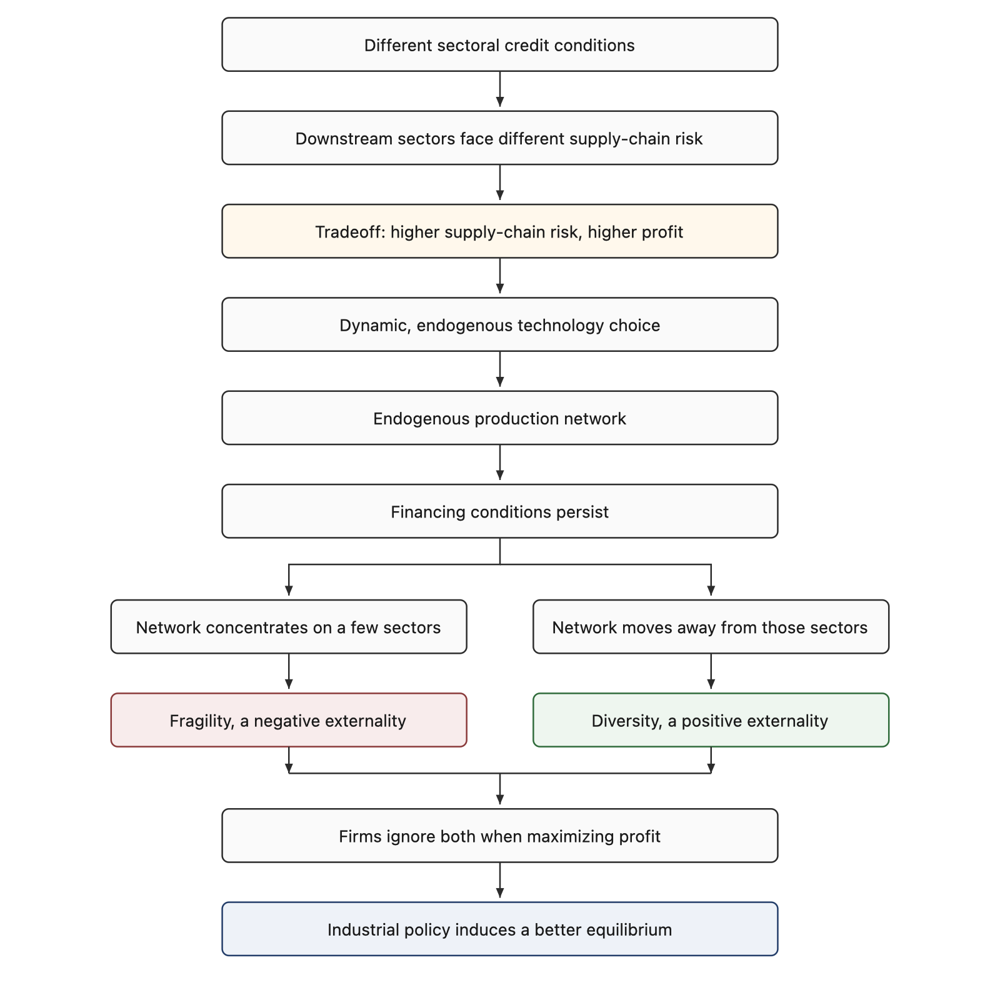

# Oct 16, Meeting with Xinyu

Hongyi and Xinyu. Follow-up on Marc's comments and on how to join financial constraints with an endogenous production network.

## Consensus

Sectors face different credit conditions, so downstream sectors face different levels of supply-chain risk. Higher supply-chain risk comes with higher profit. That tradeoff makes each sector's technology choice dynamic and endogenous, and the production network is the result of those choices.

Financing conditions are persistent, so the network can keep concentrating on a few sectors or moving away from them. Concentration brings a negative externality, fragility. Moving away brings a positive externality, diversity. Firms ignore both when they maximize profit. Industrial policy can push the economy toward the better equilibrium.

## Quick review

The meeting was about the joint project: why financial constraints and a production network belong in the same model, and why the network should be endogenous. They went back over Marc's feedback, which centers on three questions: why financial constraints, why a production network, and why an endogenous production network.

Hongyi pointed to *Real Credit Cycles* as empirical motivation. The paper links credit cycles to economic instability and generates volatile credit with diagnostic expectations and moderately predictable individual shocks. They then discussed how the model should put risk against reward: firms choose a production network, and that choice has to respond to differences in sectoral credit conditions.

They closed on data. The story needs evidence of heterogeneous financial conditions across sectors, and it should be built from datasets that already exist.

## Discussion

### Marc's three questions

Marc's comments are the starting point. The open questions are:

1. Why does the model need financial constraints?
2. Why does it need a production network?
3. Why does that network need to be endogenous, rather than taken as given?

The project has to answer these together. The reason for the financial friction and the reason for the network are the same object: sectoral credit conditions change technology choice, and technology choice is the network.

### Concentration, fragility, and where fragility is built

Hongyi's earlier results: since 2000, every cycle has come with higher input concentration, and the rise is especially clear in recessions. Fragility is built during good times. When conditions are easy, the economy accumulates a more concentrated input structure; when conditions turn, that structure is what amplifies the downturn.

They discussed how to show this. One route is US production-network data over time. Another is comparing countries with different financial conditions, and using that comparison to argue for an endogenous domestic network. They settled on the first route. A cross-country comparison is not necessary. US time series with changing financial conditions is enough.

### Why a financial constraint: *Real Credit Cycles*

On the financial-constraint question, Hongyi recommended *Real Credit Cycles*. The paper uses diagnostic expectations to generate large credit-cycle volatility out of individual shocks that are only moderately predictable. The discussion also covered what happens when productivity is realized, and how that realization is tied to default risk.

### Own constraint versus others' constraints

Default risk and the credit constraint matter because they change technology choice and therefore the network. Hongyi's point: a firm's own credit constraint does little to its technology choice directly. What matters is other sectors' credit conditions, which move prices and, through prices, the firm's technology decision. Hongyi was not sure this came across, and plans to check the argument with another faculty member the same afternoon.

### Risk versus reward

They discussed putting cost-share differences into a CES production function. The agreed link is the one in the consensus above: higher supply-chain risk comes with higher profit, and that tradeoff is what makes technology choice, and therefore the network, endogenous.

### Industrial policy and how to split the paper

They agreed on the frame. Sector-level credit conditions are the measure of supply-chain risk, and the production-network choice is what turns those conditions into economic fragility. Hongyi suggested splitting the research into two parts. Existing datasets can carry the empirical story; no new data collection is required for the first pass.

## Next steps

- **Xinyu:** Read *Real Credit Cycles*, with attention to its data and method. Try to contact the author (now at a business school, formerly at the University of Hong Kong) about the paper. Look at the production-network data Hongyi shared (the it12 dataset) and run a first exploratory pass.
- **Hongyi:** Keep debugging the mm tool and move it over, so it can build the paper index and knowledge base.
- **Both:** Meet again in two weeks to check progress.
